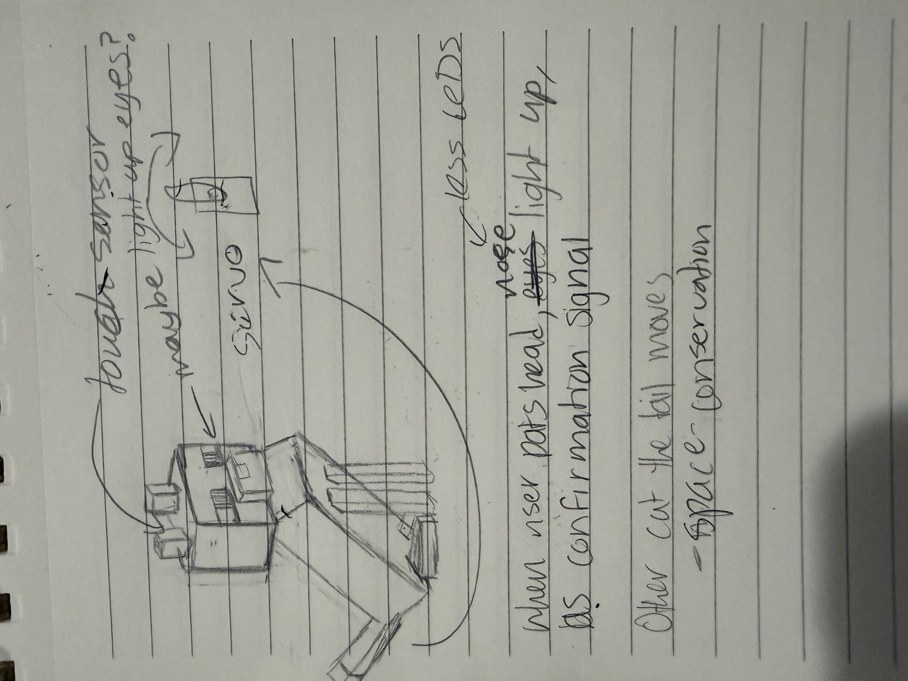
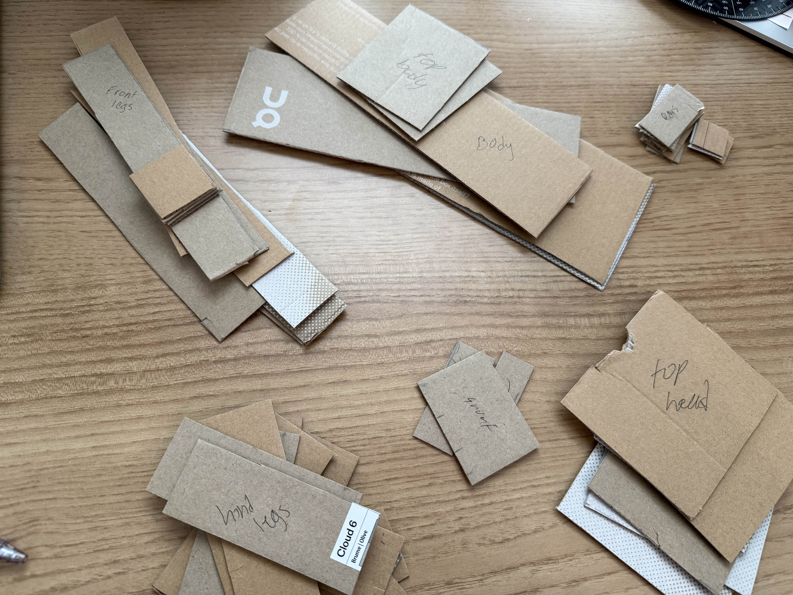
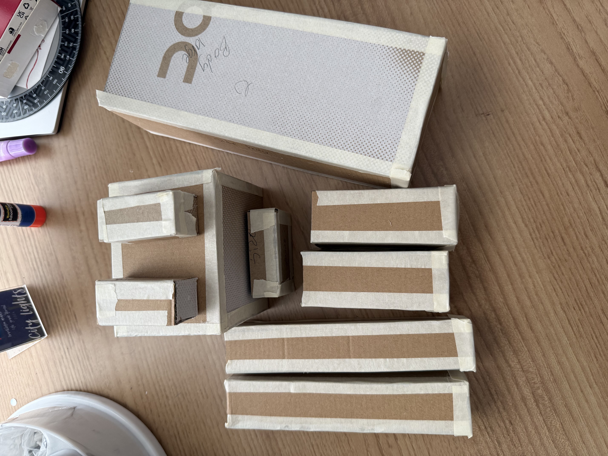
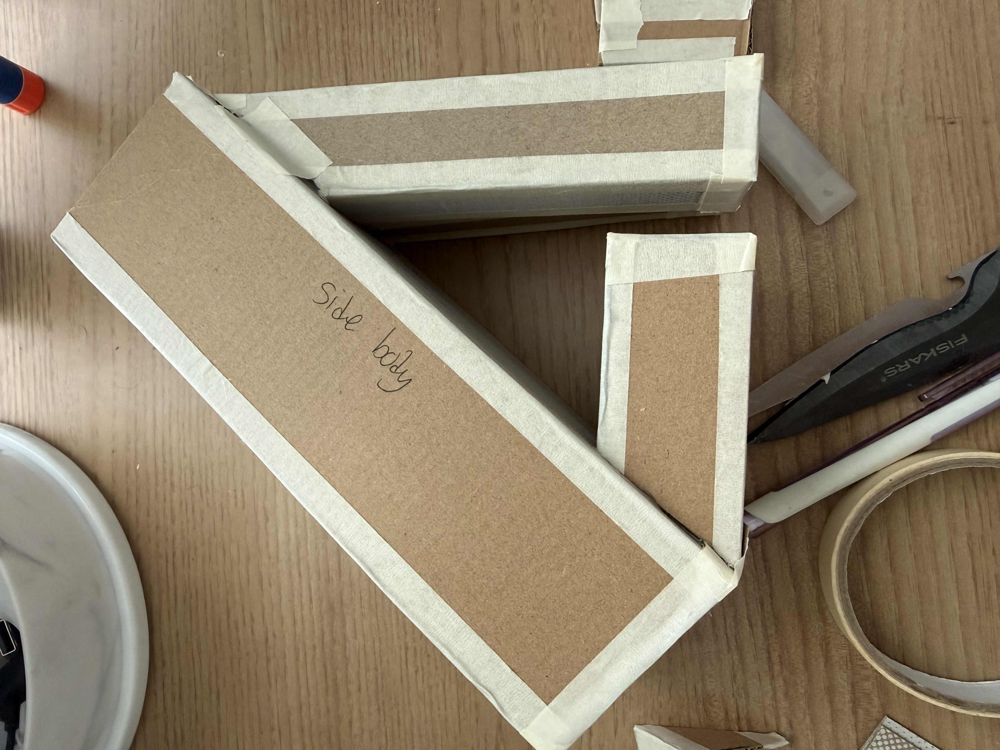
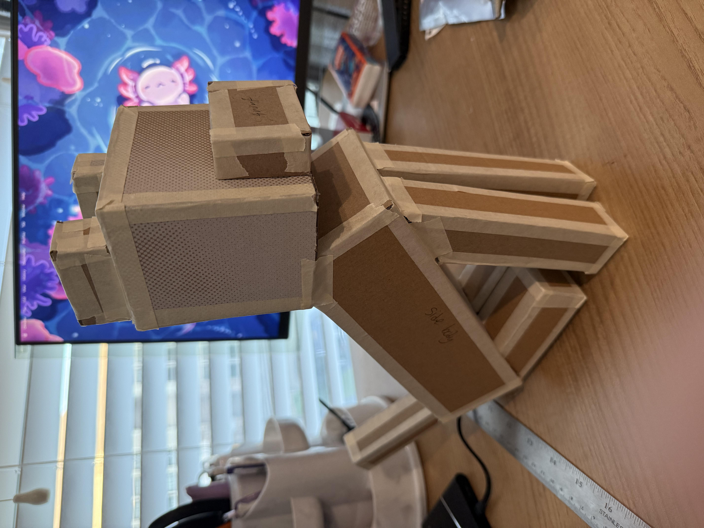
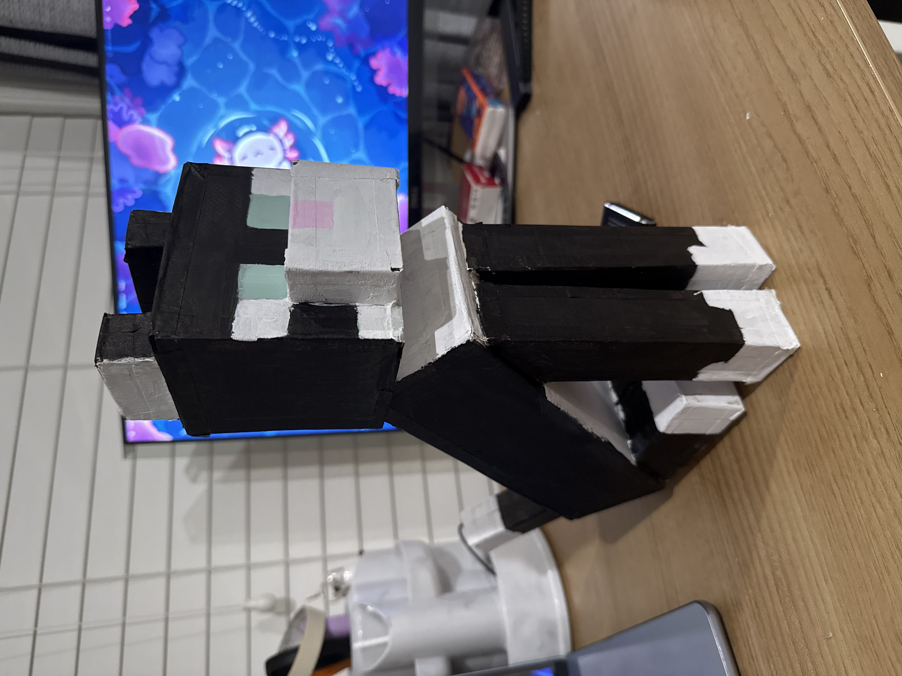
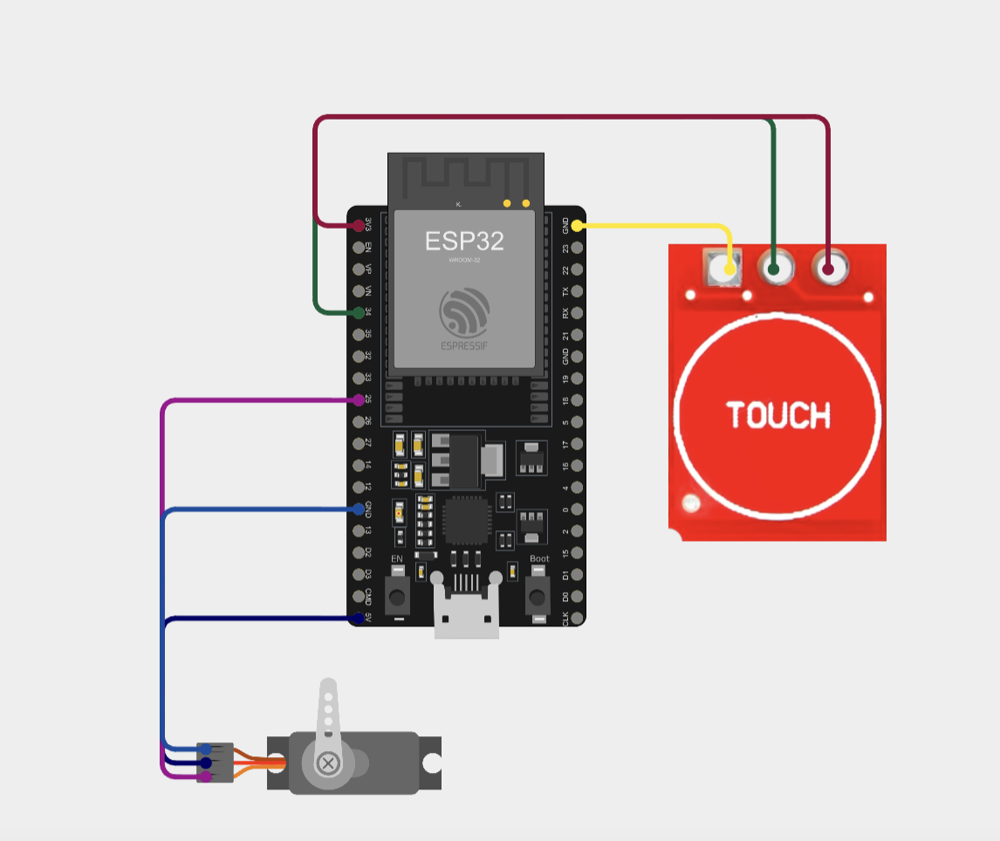

# minecraft_cat
A cardboard minecraft cat that wags its tail when you pat its head!

## Process

Planning

Cutting the pieces out

Taping the pieces together to make the overall parts

Creating the main body

Assembling the full body

Painted the full cat based on the Tuxedo Minecraft Cat skin

## Materials
- 2 shoeboxes worth of thin cardboard
- 1 MG90 servo
- 1 Touch sensor
- White and Black paint
- Female to Male Jumper Wires
- Male to Male Jumper Wires
- Masking Tape
- Hot Glue

## Wiring Diagram

